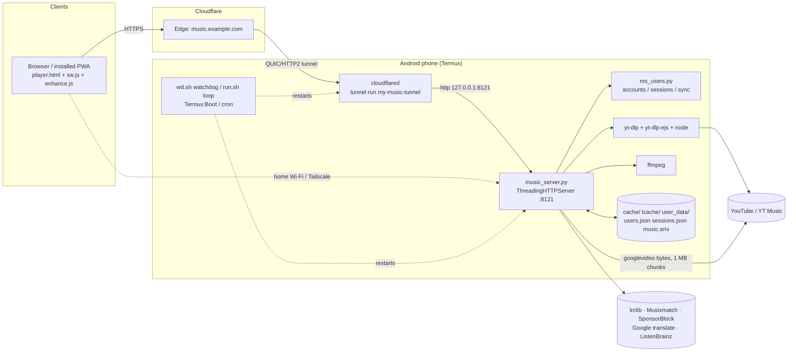

# Architecture

## Components

| Part | File(s) | What it does |
|---|---|---|
| **HTTP server** | `music_server.py` | One Python process built on `http.server.ThreadingHTTPServer` (one thread per connection, no framework, no database). It serves the player, the JSON APIs and the media byte streams, and runs background worker threads. It listens on `MUSIC_BIND:MUSIC_PORT` (live: `0.0.0.0:8121`; the code's default port is 8120). |
| **Accounts / sessions / sync** | `ms_users.py` (imported as `_MSU`) | Username and password accounts (PBKDF2-SHA256, 310k iterations), server-side sessions (cookie `ms_sess`), roles (`admin`, `user`), lockouts, per-user settings sync (`/api/state`), the admin users page, first-run `/setup`, local-only `/recover`, and a CLI (`create-admin`, `recover`). |
| **Extractor** | `yt-dlp` (pip `yt-dlp[default]`, which pulls in **yt-dlp-ejs**) + a JS runtime (`node`, set by `YTDLP_JS_RUNTIME`) | Resolves YouTube / YouTube Music stream URLs, flat playlists, mixes and search. It runs **in-process** (`yt_dlp.YoutubeDL`, with the EJS player cache switched on) and falls back to the CLI. Player clients: `visionos` first (when `YTDLP_VISIONOS=1`), then the yt-dlp defaults; a failing client is remembered per video (`_KBAD`) and visionos is switched off for 30 min after repeated failures. |
| **Transcoder** | `ffmpeg` (optional) | Used only for `/stream` (mp3 fallback) and `/dl` (mp3 download), capped by `MAX_FFMPEG`. Normal playback is the original m4a/opus bytes with no transcode. If ffmpeg is missing, `/dl` serves the original m4a/webm. |
| **Player / PWA** | `player.html` (single file, ~2,400 lines, inline JS/CSS), `sw.js` (service worker, cache `ms-v81`), `/manifest.webmanifest` (generated), icons | The whole UI: search, queue, radio, library, offline songs, lyrics, karaoke, video, themes and skins, the visualizer and dancer hosts, Diagnostics. Settings live in `localStorage` and are synced to the server for signed-in users. |
| **Enhance** | `vendor/enhance/enhance.js` (source in `_enhance/`) | Client-side only. Audio: 10-band EQ, bass, clarity, stereo width and a limiter (Web Audio), placed after the player's loudness levelling. Video: AMD FSR 1 upscale/sharpen in WebGPU/WebGL over the muted `<video>`. If anything fails, it falls back to plain audio/video. |
| **Visualizers / dance** | `vendor/` (three.js, three-vrm, pixi/live2d), `assets/viz`, `assets/dance` (clips.json), `assets/chars` (VRM/Live2D models), `viz-demo/`, `game.js` (Groove Brawl) | Run in the browser. Model PNGs over 150 KB are re-encoded to WebP on the fly (needs Pillow). **18+ tier:** paths under `/assets/{dance,chars/vrm,viz}/adult/` return 404 unless the signed-in user has `adult_viz` on, are sent `no-store`, and are never cached by the service worker. |
| **Visuals updater** | `scripts/viz-update.py` (+ `.sh` / `.cmd` wrappers) | Weekly (Monday 04:00 IST), low priority. Pulls CC0/CC-BY/MIT dance clips and Poly Haven HDRIs (butterchurn presets dropped with Trippy, 2026-11-11) from a hard **allowlist** of URLs, checking the licence of each item. Limits: 50 MB of network and 1 GB on disk. Changes are merged atomically and the last-good catalog is kept. **No server restart:** the player reads `clips.json` / `rev.js` the next time it opens. |
| **Lyrics** | `lyrics()`, `karaoke()`, `translate()` in music_server.py | Synced/plain lyrics from **lrclib.net**. Word-level karaoke comes from `syncedlyrics` (Musixmatch richsync, 12 s cap). Translation goes to Google's public `translate_a/single` (gtx) endpoint in 40-line chunks. Results are cached under `lcache/`. |
| **SponsorBlock** | `/api/segments` | Fetches segments from `sponsor.ajay.app/api/skipSegments`; the player skips the categories the user picked (`sbCats`). |
| **Radio / recommendations** | `radio()`, `similar()`, `chips()`, `home`, `suggest()`, `record_play()` | Builds the queue from YouTube Music mixes (`RDAMVM<id>`), a similarity lane, language bias (te 0.40 / hi 0.35 / en 0.25), junk filters (movies, interviews, live) and a "song family" matcher (`famkey.js` + `famlang.py`), so duplicate or dubbed versions aren't queued twice. `/api/similar` uses Last.fm if `LASTFM_KEY` is set, otherwise ListenBrainz/MusicBrainz. Radio is cached for 2 h (`lcache/radio`). Plays are recorded in `lcache/plays` and per user. |
| **Listen together** | `/api/room` | In-memory rooms: a host pushes `{id,title,t,p}` and guests poll. Rooms expire after 2 h idle. |
| **Downloads** | `/api/dl/start`, `/api/dl/status`, `/dlfile`, `/dl` | Background download jobs (`MAX_ACTIVE_DL`). Offline songs are saved by the browser in Cache Storage `off`. |
| **Server-side playback** | `/cmd`, `/pc/play`, `/pc/stop` | Plays on the server machine itself with `ffplay`. Needs the real key or the owner. |
| **Telegram** | `tg_loop` | Off unless `MUSIC_BOT_TOKEN` is set (it isn't, on the phone or the desktop). |

## Diagram

## Request flows

### Search (`GET /api/search?q=`)
1. `guard()` runs on every request. It works out network trust (`_trust_reason`), the signed-in user (`ms_sess`) and the rate limit (search counts as a "heavy" bucket: 120 per minute per client, plus a 900 per minute per-IP ceiling).
2. Identical searches that are already in flight share one result (`_single`). Then the memory cache (30 min), then the disk cache `lcache/search` (`SEARCH_DISK_TTL`, 6 h).
3. With `SEARCH_FAST=1` (the default), a direct InnerTube call (`youtubei/v1/search`, 6 s timeout) is tried first. If that fails or returns no videos, it falls back to a yt-dlp flat search of the results page.
4. Live and upcoming streams are dropped. Mixes and playlists come back as `kind: mix|playlist`.

### Audio stream and seek (`GET /audio?id=&q=std|hi`)
1. `get_blob(vid, fq)` returns a *blob* for the video and quality:
   - from memory (3 h)
   - else from disk `cache/<id>_<fq>.bin` + `.ok` (valid for `BLOB_DISK_TTL`, 30 days, survives restarts)
   - else it resolves a fresh URL. Resolved URLs are cached in `lcache/urls`; the order is visionos, then default clients, then the CLI, up to 3 tries.
2. The blob downloads the upstream file in **1 MB chunks** (global cap `MAX_FETCH`), with priority for the chunk the listener needs next. The disk cache is trimmed to `CACHE_MAX_GB`.
3. A `Range: bytes=a-b` request gets **206 Partial Content** with `Content-Range`. No Range gets 200. A Range past the end gets 416. Seeking is just a new Range request; the server waits only for the chunks it needs.
4. Live or upcoming videos get **409** (`_live409`). An upstream failure after 3 tries gets 502, and the player's stall watchdog then cycles formats or skips.
5. Formats: `std` = `bestaudio[ext=m4a]/bestaudio`, `hi` = `bestaudio[acodec=opus]/bestaudio`.

### Video (`GET /video?id=&r=360&c=h|av1`)
- The player plays the **audio element as the clock** and a **muted `<video>`** synced to it.
- Renditions are 144–1440p. H.264 (`avc1`, mp4, http) is preferred by default; AV1 only when `c=av1`.
- `/api/vinfo` lists the heights that are really available. `_vwarm` pre-resolves them.

### Login / session / sync
- **First run:** `/setup` creates the first admin. It only works from a *local client* (LAN/Tailscale/loopback with no proxy or tunnel headers), never through Cloudflare.
- **Sign in:** `POST /api/auth/login` sets the `ms_sess` cookie (random 256-bit token; only its SHA-256 is stored; HttpOnly, SameSite=Lax, Secure over HTTPS).
  - "Keep me signed in" lasts 1 year; otherwise it expires after 12 h idle.
  - Sessions slide forward as they're used, with at most 50 per user.
- **Legacy key:** `?k=<MUSIC_KEY>` still works. The server then sets an `ms_auth` cookie so the key doesn't need to stay in URLs. `ms_cid` is a per-browser id used for rate-limit buckets.
- **Sync:** the player reads and writes `/api/state`. Almost every `localStorage` key follows the user across devices (`SYNC_KEYS` plus a generic rule, up to 600 keys and 3 MB). A short `SYNC_DENY` list stays on the device (device id, bandwidth estimates, the 18+ toggle and so on). The state is stored in `user_data/<user>.json`.
- **Admin:** `/users` (page) and `/api/users` let an admin manage users: create, rename, disable, set role, reset settings, drop sessions, and the 18+ flag.

## Where state lives

| State | Location | Backed up by ms-backup.sh |
|---|---|---|
| Settings + key | `music.env` (secret) | yes |
| Accounts | `users.json` (hashes; secret) | yes |
| Sessions | `sessions.json` (token hashes; secret) | yes |
| Per-user settings, library and history | `user_data/<user>.json`, `user_data/<user>.plays.json` | yes |
| Global play history | `lcache/plays/plays.json` | yes |
| Search / URL / radio caches | `lcache/search`, `lcache/urls`, `lcache/radio` | no (rebuilt) |
| Song and video bytes | `cache/*.bin` + `*.ok`, `cache/webp/` (5.1 GB on the phone) | no (rebuilt) |
| yt-dlp health | `ytdlp_update.json`, `ytdlp_version.txt`, `ytdlp_heal.txt`, `.ytdlp_update.stamp` | no |
| Logs | `server.log`, `run.log`, `ms-update.log`, `~/cf/tunnel.log` | no |
| Visual catalogs | `assets/viz`, `assets/dance/clips.json`, `assets/viz/update/` (stamp, disabled flag, last-good) | code yes; models only with `--with-assets` |
| Browser side | `localStorage` (settings), Cache Storage `ms-v81` (shell, skins, vendor, assets), `off` (offline songs and art) | — |
| In memory only | rooms, rate-limit counters, lockout counters (rebuilt from `users.json` `unlock_at` on reload), blob table | — |
